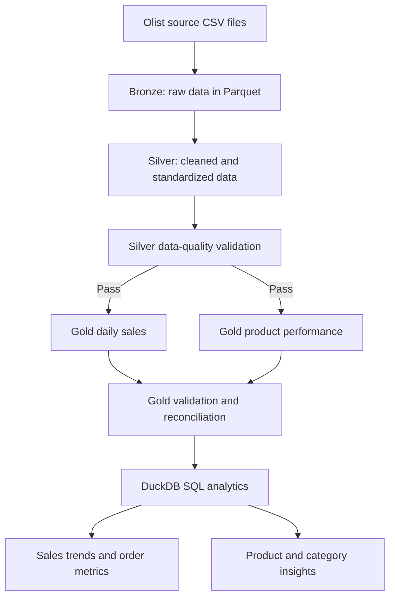

# Olist E-commerce Analytics Pipeline

An end-to-end, locally runnable data engineering project built with **Python, PySpark, Parquet, DuckDB SQL, and data-quality checks**. It transforms Brazilian Olist e-commerce data into analytics-ready Gold datasets for sales and product performance.

> **Project type:** Batch ETL portfolio project  
> **Processing:** Local Apache Spark  
> **Storage:** Parquet files  
> **Analytics:** DuckDB + SQL

## Business problem

Raw order, order-item, customer, payment, and product files are useful for analysis only after their schemas, relationships, and business definitions are made consistent. This project builds a repeatable pipeline that prepares those data for sales reporting and product-level analysis.

## Key results

The latest successful local Gold-layer verification reported:

| Metric | Result |
|---|---:|
| Daily sales records | 612 |
| Delivered orders included in sales reporting | 96,478 |
| Products in the product-performance table | 32,951 |
| Units sold in delivered orders | 110,197 |
| Product revenue | R$ 13,221,498.11 |
| Freight revenue | R$ 2,198,275.64 |
| Total revenue (product + freight) | R$ 15,419,773.75 |
| Revenue reconciliation | Passed; difference R$ 0.00 |

**Business rule:** Both Gold sales datasets use delivered orders. Product performance retains the full product catalog, so products with no delivered sales can still appear with zero sales metrics.

**Metric note:** The sum of `total_orders` across products is a product-level count, not the number of unique orders overall. An order containing multiple products can contribute to multiple product rows. Use the daily sales table for the overall delivered-order count.

These figures are the results from the current local run; results can vary if the input dataset or pipeline logic changes.

## Architecture



## Technology stack

- **Python** — pipeline scripts and orchestration
- **PySpark** — distributed-style DataFrame transformations running locally
- **Parquet** — columnar storage for Bronze, Silver, and Gold datasets
- **DuckDB + SQL** — analytical queries over Parquet
- **Git/GitHub** — version control and project documentation

## Pipeline workflow

Run the complete pipeline from the project root:

```bash
python src/run_pipeline.py
```

The orchestrator runs these stages in order and stops if a stage fails:

1. Ingest raw CSV files into Bronze Parquet datasets.
2. Transform source data into Silver datasets.
3. Validate Silver data.
4. Build the Gold daily-sales table using delivered orders.
5. Validate the daily-sales table.
6. Build the Gold product-performance table using delivered order items while retaining the catalog.
7. Validate product performance and revenue reconciliation.
8. Execute the analytical SQL queries in `sql/gold_analytics.sql`.

## Repository structure

```text
.
├── data/
│   ├── raw/          # Input CSVs (not committed)
│   ├── bronze/       # Generated Parquet (not committed)
│   ├── silver/       # Generated Parquet (not committed)
│   └── gold/         # Generated Parquet (not committed)
├── docs/
│   └── PROJECT_PRESENTATION.md
├── sql/
│   └── gold_analytics.sql
├── src/
│   ├── ingest_bronze.py
│   ├── transform_silver.py
│   ├── validate_data.py
│   ├── build_gold_daily_sales.py
│   ├── validate_gold_daily_sales.py
│   ├── build_gold_product_performance.py
│   ├── validate_gold_product_performance.py
│   ├── run_sql_analytics.py
│   └── run_pipeline.py
├── requirements.txt
├── .gitignore
└── README.md
```

Generated data and raw source files are excluded from Git to keep the repository lightweight. The pipeline creates the local data directories and outputs when it runs.

## Setup

### Prerequisites

- Python 3.10 or newer
- Java 17 (recommended for this project) configured in `JAVA_HOME` / `PATH`
- The Olist CSV dataset downloaded locally

### 1. Create and activate a virtual environment

Linux / WSL:

```bash
python3 -m venv .venv
source .venv/bin/activate
python -m pip install --upgrade pip
python -m pip install -r requirements.txt
```

Windows PowerShell:

```powershell
py -m venv .venv
.\.venv\Scripts\Activate.ps1
python -m pip install --upgrade pip
python -m pip install -r requirements.txt
```

### 2. Add source CSV files

Place the required files under `data/raw/`:

- `olist_orders_dataset.csv`
- `olist_order_items_dataset.csv`
- `olist_customers_dataset.csv`
- `olist_order_payments_dataset.csv`
- `olist_products_dataset.csv`

The dataset is not bundled in this repository. Obtain it from the public Brazilian E-Commerce Public Dataset by Olist on Kaggle and follow its terms of use. Confirm the filenames match the ingestion script before running the pipeline.

### 3. Run the pipeline

From the repository root:

```bash
python src/run_pipeline.py
```

The pipeline writes Parquet datasets under `data/bronze/`, `data/silver/`, and `data/gold/`, runs validation steps, and prints SQL analytics.

## SQL analytics included

The SQL file demonstrates:

- Daily sales and delivered-order reporting
- Top products by revenue
- Revenue by product category
- Products with no delivered sales
- Category ranking using `DENSE_RANK()`
- Category contribution using window aggregates
- Day-over-day sales comparison using `LAG()`
- Conditional aggregation for sold versus unsold products

Run the SQL stage independently after building Gold data:

```bash
python src/run_sql_analytics.py
```

## Data-quality approach

The validation scripts check core table properties and business-level consistency, including:

- Expected output tables and required columns
- Unique daily dates and unique product identifiers
- Required-field and product-coverage checks
- Revenue reconciliation between daily and product Gold outputs

The delivered-order filter is applied consistently to both Gold datasets so that their product-revenue and freight-revenue totals can be reconciled.

## Design decisions worth discussing

1. **Bronze / Silver / Gold separation:** isolates ingestion, standardization, and business-ready aggregation.
2. **Parquet storage:** supports compact columnar datasets and analytical reads.
3. **Delivered-order scope:** makes the sales metric definition explicit and consistent.
4. **Catalog-preserving product join:** keeps products with no delivered sales visible for coverage analysis.
5. **Reconciliation checks:** tests totals across independently aggregated Gold tables, not just row counts.
6. **DuckDB SQL over Parquet:** allows analytical SQL without requiring a separate database server.

## Scope and limitations

This is a local batch pipeline intended to demonstrate data-engineering fundamentals. It does not currently include cloud deployment, scheduled orchestration, streaming ingestion, or production monitoring. A dashboard may exist in a separate local working copy; it is not described here as a repository deliverable unless its source and setup instructions are committed.

## Next improvements

- Add automated tests for transformation edge cases.
- Add a reproducible dashboard folder and screenshots if the dashboard is part of the final deliverable.
- Add CI to run linting and validation tests on pushes.
- Add configurable input/output paths and structured logging.
