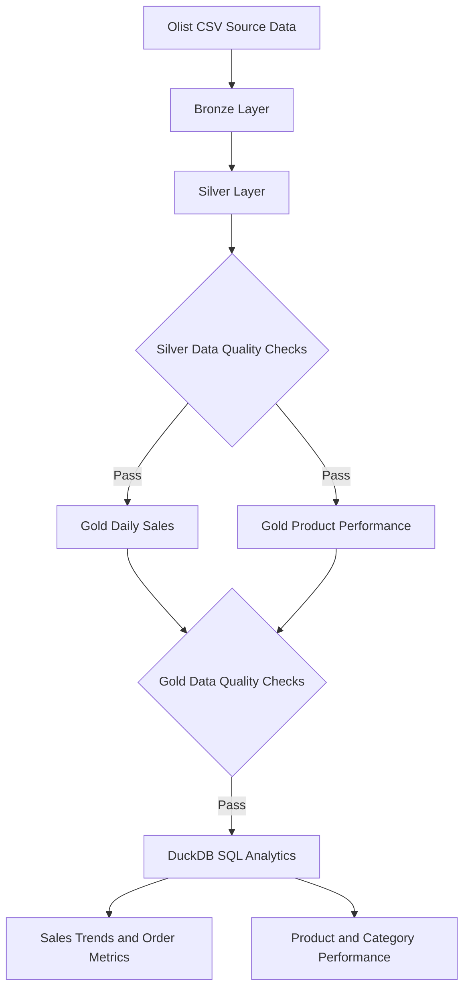

# E-Commerce Data Engineering Pipeline

An end-to-end e-commerce data engineering project built with Python, PySpark, Parquet, and SQL using the Brazilian Olist e-commerce dataset.

The project ingests raw source data, transforms it through Bronze, Silver, and Gold layers, validates data quality, and produces analytics for sales and product performance.

## Project Objectives

- Build a repeatable, locally executable ETL pipeline.
- Organize data into Bronze, Silver, and Gold layers.
- Use Python and PySpark for ingestion and transformations.
- Store intermediate and analytical datasets in Parquet format.
- Validate schema, uniqueness, nulls, revenue calculations, and record reconciliation.
- Answer business questions using SQL analytics.

## Architecture



The pipeline follows a Bronze → Silver → Gold architecture. Raw CSV files are ingested into Parquet, transformed with PySpark, validated, and queried using DuckDB SQL.


## Technology Stack

- Python and Pandas for ingestion
- PySpark for data transformations
- Parquet for columnar storage
- DuckDB and SQL for analytics
- Git and GitHub for version control

## Pipeline Workflow

The `src/run_pipeline.py` orchestrator executes these steps:

1. Bronze ingestion
2. Silver transformations
3. Silver data validation
4. Build Gold daily sales
5. Validate Gold daily sales
6. Build Gold product performance
7. Validate Gold product performance
8. Run SQL analytics

The pipeline stops if any step fails.

## Data Quality Results

The current local validation results are:

| Check | Result |
|---|---|
| Gold daily-sales records | 612 |
| Orders reconciled | 96,478 |
| Gold product-performance rows | 32,951 |
| Duplicate daily dates | None detected |
| Duplicate product IDs | None detected |
| Revenue reconciliation | Passed |
| Required-column null checks | Passed |
| Product coverage | 32,951 catalog products; no coverage gaps reported |

The complete pipeline previously finished successfully in approximately 68 seconds in the local environment. Runtime depends on hardware and environment.

## SQL Analytics

The SQL queries analyze:

- Daily sales and order trends
- Top products by revenue
- Revenue by category
- Category revenue rankings and contribution percentages
- Day-over-day sales changes
- Product coverage and revenue summaries

## Project Structure

```text
.
├── data/
│   ├── raw/       # Local CSV files; excluded from Git
│   ├── bronze/    # Generated Parquet data
│   ├── silver/    # Transformed data
│   └── gold/      # Analytics-ready datasets
├── docs/
├── sql/
├── src/
├── tests/
├── .gitignore
└── README.md
```

## Run Locally

### Prerequisites
- Python 3.14 or a compatible Python version supported by the installed dependencies
- Java configured for PySpark
- The Olist CSV dataset placed in `data/raw/`

### Setup
Activate your virtual environment and install dependencies:

```bash
source .venv/bin/activate
python -m pip install -r requirements.txt
```

### Execute the pipeline

```bash
python src/run_pipeline.py
```

The pipeline creates Bronze, Silver, and Gold Parquet datasets locally, validates data quality, and runs SQL analytics.

### Required source files

The current ingestion script expects these five files in `data/raw/`:
- `olist_orders_dataset.csv`
- `olist_order_items_dataset.csv`
- `olist_customers_dataset.csv`
- `olist_order_payments_dataset.csv`
- `olist_products_dataset.csv`

Raw CSV files and generated data are excluded from Git. Download the dataset separately before running the pipeline.

## Limitations

This is a local portfolio project. It demonstrates batch ETL, Parquet storage, PySpark transformations, SQL analytics, and data-quality checks. It does not currently include cloud orchestration or automated scheduled runs.
