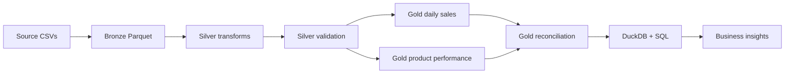

# Project Presentation: Olist E-commerce Analytics Pipeline

Use this document as a concise guide for a recruiter, code walkthrough, or junior data engineer interview.

## 1. One-line summary

I built a local batch data pipeline using Python and PySpark that converts raw Olist e-commerce CSV files into Bronze, Silver, and Gold Parquet datasets, validates the results, and uses DuckDB SQL to answer sales and product-performance questions.

## 2. Business problem

Raw e-commerce data is spread across multiple files, including orders, order items, products, customers, and payments. Before it can be used reliably for reporting, the data needs to be ingested, standardized, joined, aggregated, and checked against consistent business rules.

The project creates two business-facing datasets:
- **Gold daily sales:** daily delivered-order count, product sales, freight revenue, and total sales.
- **Gold product performance:** units sold, distinct orders per product, product revenue, freight revenue, and total revenue by product.

## 3. Architecture

## 4. Technologies and why they were used

| Technology | Role in this project |
|---|---|
| Python | Pipeline scripts and orchestration |
| PySpark | DataFrame joins, filtering, grouping, and aggregation |
| Parquet | Columnar storage between pipeline layers |
| DuckDB | Query Parquet outputs with analytical SQL |
| SQL | Rankings, conditional aggregation, and window functions |
| Git/GitHub | Version control and technical documentation |

## 5. Results from the verified local run

| Metric | Result |
|---|---:|
| Daily Gold records | 612 |
| Delivered orders | 96,478 |
| Product catalog rows in Gold | 32,951 |
| Units sold in delivered orders | 110,197 |
| Product revenue | R$ 13,221,498.11 |
| Freight revenue | R$ 2,198,275.64 |
| Total revenue | R$ 15,419,773.75 |
| Reconciliation difference | R$ 0.00 |

The daily and product Gold datasets reconcile on product revenue and freight revenue. Results describe the current local run and depend on the source data and business rules.

## 6. Important engineering decisions

### Consistent business scope

Both Gold tables use delivered orders. Applying the same filter avoids comparing metrics calculated from different populations of orders.

### Keep unsold catalog products

The product aggregation starts from the product catalog and left-joins delivered order items. This retains products with no delivered sales, allowing sold-versus-unsold product coverage analysis.

### Validate totals, not only row counts

A dataset can have the expected number of rows and still contain incorrect metrics. The pipeline includes checks for uniqueness and revenue reconciliation between independent aggregations.

### Be precise about order counts

The sum of product-level `total_orders` values is not the same as the number of unique delivered orders overall. One order can contain multiple products and therefore appear in multiple product groups. The daily-sales table provides the overall delivered-order count.

## 7. Example SQL concepts demonstrated

- `GROUP BY` for daily and category aggregates
- `CASE WHEN` for sold/unsold counts
- Common table expressions (CTEs) to stage ranking calculations
- `DENSE_RANK()` to rank categories by revenue
- `LAG()` to compare sales with the previous recorded date
- Window aggregates to calculate category revenue contribution

## 8. 60-second interview explanation

“I built an end-to-end batch ETL project on the Olist e-commerce dataset. The pipeline ingests CSV files into a Bronze layer, cleans and standardizes data into Silver using PySpark, and creates Gold tables for daily sales and product performance. I store the layers as Parquet and use DuckDB SQL for analytics such as top products, category rankings, and day-over-day sales changes.

One important issue I addressed was business-rule consistency: both Gold tables must use delivered orders, otherwise revenue totals will not reconcile. I also preserve the product catalog with a left join so products with zero delivered sales remain available for coverage analysis. I added validation for uniqueness and revenue reconciliation. In my latest local verification, 96,478 delivered orders and R$15.42 million in product-plus-freight revenue were reconciled with a zero difference.”

## 9. Likely interview questions

**Why use Bronze, Silver, and Gold?**  
They separate raw ingestion, cleaned/standardized data, and business-ready aggregates. This makes the pipeline easier to debug, validate, and extend.

**Why Parquet instead of CSV for intermediate data?**  
Parquet is columnar, preserves schema types more effectively, and is well suited to analytical reads.

**Why PySpark?**  
It provides DataFrame APIs for joins and aggregations and scales to distributed processing patterns. In this project, it runs locally; this is not a claim of a deployed Spark cluster.

**Why DuckDB?**  
It can query Parquet directly with SQL without setting up a separate database server.

**How did you validate the Gold layer?**  
I checked row/key uniqueness and reconciled product and freight revenue between the daily and product aggregations.

**Why can product-level order counts sum to more than unique orders?**  
An order can contain multiple products, so it contributes to the order count for each product included in that order.

**What would you improve for production?**  
Add automated tests and CI, structured logging, configurable environments, scheduled orchestration, monitoring, incremental processing, and cloud storage.

## 10. Honest project scope

This project demonstrates local batch ETL and analytics. It is not yet a production cloud pipeline: it has no deployed orchestration service, scheduled runs, streaming ingestion, or production monitoring. Describe only components that are actually present in the repository and that you can explain in detail.
